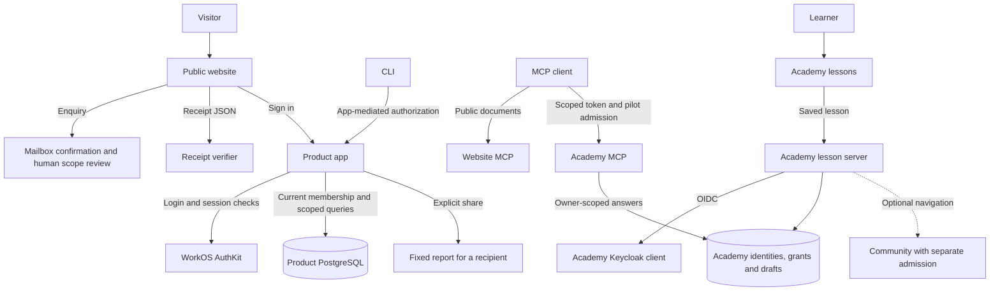

# WitnessOps Web architecture

A visitor can ask for a security review, inspect public proof examples, or sign in to a product workspace. A learner can use Academy. Each journey has its own rules for identity, access and evidence. This map covers the product repository. The [governed workflow overview](content/witnessops/docs/security-systems/witnessops-architecture.mdx) explains the wider evidence model.

## Components and data flow

Arrows show calls or handoffs implemented on the commercial source line. The dashed community link requires configuration.

### From enquiry to engagement

The website presents the offer, examples and a fit enquiry. The review form posts a non-secret scope summary to `/api/review/request`. The server checks the offer, validates the business email, applies rate limits and captures the offer revision when it issues the verification code. Entering the code at `/api/verify-token` confirms access to the mailbox. The [intake state transition](apps/witnessops-web/src/lib/server/token-issuance.ts) records verification, admits the intake and requests an operator notification. Email delivery depends on the configured mail provider. A human still agrees scope, authority, evidence handling, fee and timing before work starts. A requested meeting time requires a separate invitation. Historical agreements keep their own revisions and terms. See the [intake implementation](apps/witnessops-web/src/lib/server/review-request-intake.ts), [code confirmation route](apps/witnessops-web/src/app/api/verify-token/route.ts) and [commercial index](docs/commercial/README.md).

### Identity, sessions and workspace data

WorkOS AuthKit implements product login and session validation. A signed-in identity maps to an internal user. Separate workspace membership and role checks govern each protected resource. [Product app contract](apps/witnessops-app/README.md) · [Login route](apps/witnessops-app/src/app/login/route.ts)

A separate [product Keycloak candidate](https://github.com/witnessops/witnessops-web/pull/596) at `df1c9044d068` adds optional provider selection, explicit linking from an active WorkOS session, encrypted PostgreSQL token storage and session revocation. Those features belong to that candidate. The commercial branch starts from `4a839651dec9` and retains the WorkOS product implementation.

PostgreSQL owns users, mappings, workspaces, memberships, saved source snapshots, results and report revisions. Workspace resource operations check current membership and the role or capability required for the action. Owner, Contributor and Viewer have different rights. The app enforces tenant isolation through membership checks and workspace-scoped queries. Database row-level security is deferred. Collection requires its own explicit authority, including for invited or paying workspace members. The app admits supported imports and scoped runs, retains the original evidence and lets an authorized Owner share a fixed recipient projection. Recipient access is separately checked and revocable. See the [API and authorization boundaries](apps/witnessops-app/src/lib/api-contract.ts) and [database implementation](apps/witnessops-app/src/lib/db/).

### Evidence, packages and interfaces

| Component | What the source implements |
| --- | --- |
| Public verification | `/verify` and `/api/verify` evaluate untrusted receipt JSON through the same adapter. An indeterminate result preserves missing evidence. These routes neither issue receipts nor verify an arbitrary evidence bundle. The sample page has a separate verifier for one pinned, signed synthetic specimen. [Receipt adapter](apps/witnessops-web/src/lib/verify-adapter.ts) · [Sample contract](apps/witnessops-web/src/app/review/sample-cases/ai-agent-action-proof-run/sample-artifact-contract.ts) |
| Shared packages and CLI | UI, content, configuration and catalogue packages support the apps. The proof package supplies receipt checks. Ask authority supplies curated data to a bounded server consumer. The CLI has a public fit-enquiry command and separate app-mediated workspace/session and execution authorizations. Capture, import and conditional finalization have distinct admission rules. [Packages](packages/) · [CLI contract](packages/wops-cli/README.md) · [Finalizer contract](deploy/app/FINALIZER_RUNTIME.md) |
| Public and administrative MCP | Stateless public `/mcp` offers document search, fetch and bounded guidance. `/mcp/directory` offers search and fetch. The separate administrative MCP route defaults off and requires an enabled, audited, scoped bearer client for allowed reads. Public documentation calls confer no workspace or administrative access. [Public handlers](apps/witnessops-web/src/app/mcp/) · [Admin gate](apps/witnessops-web/src/lib/server/admin-mcp/gate.ts) |
| Academy and community | The static Academy serves previews. Its lesson server supports Keycloak sessions and PostgreSQL drafts keyed to a learner and lesson. The protected Academy MCP checks token identity, resource, scope and current pilot admission before its learner tools may access saved answers. Community navigation is optional. The community operates its own room admission and removal. Neither a product workspace nor an Academy pilot grant creates community membership. [Static Academy](apps/witnessops-academy/README.md) · [Lesson and community boundaries](apps/witnessops-academy-server/README.md) · [MCP service](apps/witnessops-academy-mcp/src/server.mjs) |

## What has been established

The commercial source baseline is `4a839651dec9`. It includes the Academy Decision Room and removes promotional Academy navigation from the buyer journey. The [offer contract](docs/commercial/19-agent-action-adversarial-testing-offer.md) governs the service and its terms. Production observations below refer to the release and date identified.

| Surface | Configuration and functional evidence at the review | Production acceptance |
| --- | --- | --- |
| Website, product login, workspace, PostgreSQL | On the separate candidate only, a development browser followed the website login link through an isolated Keycloak realm into a workspace belonging to a pre-linked synthetic account. The workspace API returned 200, then 401 after logout. A new login requested credentials. This covered one seeded account. Existing-account migration, hosted provider behavior and multi-tenant isolation require their own acceptance. | On 28 November the public product login returned HTTP 307 to the WorkOS authorization endpoint. This identifies the observed entry path. Hosted session completion, deployed app revision and migration acceptance remain unverified. |
| Commercial enquiry and email | A browser submitted one synthetic enquiry through an existing offer URL, received the code in a file-backed mailbox and confirmed it. The isolated intake store contained exactly one admitted record with the same reference. The operator notification used the file provider. [Enquiry fixture](tests/public-funnel/isolated-enquiry.test.mjs) | Live customer mail delivery and receipt by the operator require separate acceptance. |
| Public receipt checks and samples | The website ships a receipt adapter and a separate sample-specific verifier. Their tests use bounded inputs and synthetic evidence. | The website release is identified below. No customer receipt or production signing key was validated here. |
| Product evidence and reports | Saved-source imports and fixed report revisions depend on current membership and configured product storage. Finalization has an additional enablement gate. | The dev login test exercised workspace reads. Production capture, finalization and recipient access remain unverified. |
| Shared packages and CLI | The site and app consume workspace packages at build time. The CLI needs app-issued authorization for a protected workspace action. | Installed CLI distribution and a hosted CLI-to-app session remain unverified. |
| Public and admin MCP | The website release includes an edge check for public MCP. Admin MCP is separately gated and defaults off. | The dated release check below passed for the public endpoint. Current admin enablement and client acceptance are unknown. |
| Academy and community | Static pages, protected lesson and MCP services, and optional community navigation have separate configuration. Public Academy registration defaults off. Local MCP tests are described below. | The public Academy landing page returned HTTP 200 on 28 November. This review did not establish hosted learner access, a working community handoff or room membership. |
| Optional product integrations | Help, invitation delivery, sandbox seat billing and finalization have separate runtime prerequisites. The synthetic review fixture is disabled in standard production builds. [Product configuration and staging contract](apps/witnessops-app/README.md) | Provider and customer acceptance unverified. |

A dated website release record identifies source `557881c84deb` on 24 November 2026. Its acceptance checks covered anonymous review and support pages, the Academy static surface and public MCP HTTP behavior. This establishes a deployment and those observations at that revision and date. The Academy static readback did not exercise an authenticated lesson. [Website release run](https://github.com/witnessops/witnessops-web/actions/runs/45450666505)

A separate 26 November local Academy acceptance record reported eight passing authenticated MCP admission and persistence checks with the lesson server and MCP at `641d0293`. This evidence concerns the temporary local services. Native ChatGPT acceptance and production promotion were still unverified. [Academy change at that revision](https://github.com/witnessops/witnessops-web/pull/602)

On 26 November, the website release for `4a839651dec9` completed [image publication](https://github.com/witnessops/witnessops-web/actions/runs/45855214903), [production promotion and public MCP checks](https://github.com/witnessops/witnessops-web/actions/runs/45858592484), then a separate [production status check](https://github.com/witnessops/witnessops-web/actions/runs/45858900897). Those jobs concern the website image. They do not identify the product app image or establish a Keycloak cutover.

## Build, release and recovery

Developers run the public site and product app separately. Node 22 and pnpm 9.15.4 are the repository toolchain. The full repository check is `pnpm health`. Database integration, browser journeys, provider behavior and release acceptance each have additional checks for their own boundary. Academy has a separate test and packaging path. See the [command contract](commands.md), [app validation workflow](.github/workflows/app-validation.yml) and [Academy checks](.github/workflows/academy-e2e.yml).

The public website release build uses `pnpm release`. The website's protected workflow distinguishes publishing an image, staging and approving production promotion. The product app has its own build, migrations, recovery and finalizer contracts. Its isolated AASR staging profile binds WorkOS. Academy has a separate static release contract. Legacy direct production paths are historical. See the [deployment classifications](docs/DEPLOYMENT_AUTHORITY.md), [app lifecycle source](deploy/app/) and [Academy release boundary](deploy/academy/README.md).

The authorized release operator owns promotion and rollback for the affected surface. Match the approved source and immutable artifact to observed runtime evidence. Before rollback, identify the prior accepted artifact and verify its compatibility with persisted data, sessions and migrations. A merge or a passing build does not establish the deployed revision. Production acceptance of the product Keycloak candidate remains open. [Release contract](RELEASE.md)
