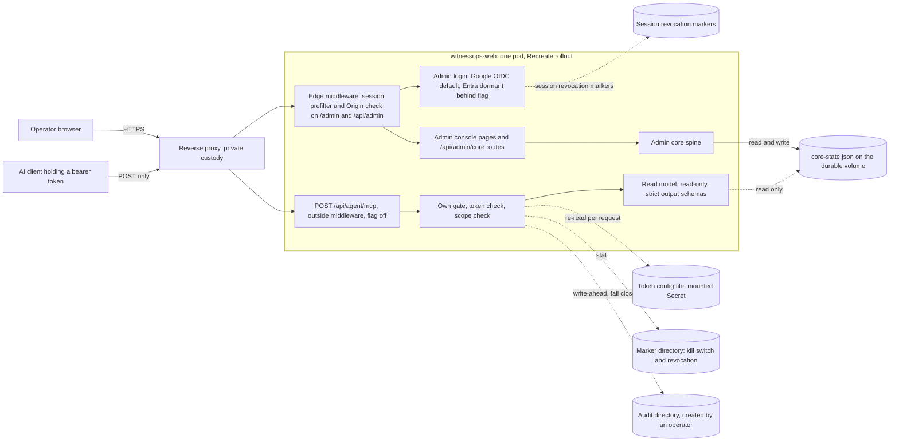

# WitnessOps admin console: architecture

**Status: DRAFT. NOT PUBLISHED.** Local file only. Nothing here has been sent to Confluence, Jira, GitHub, SharePoint or monday.
**Date:** 2026-10-25, Europe/Dublin (UTC+1). Verification pass ran about 01:30 Dublin time.
**Repo:** witnessops-web, branch `main`, head `70b787b5e144fbddc522990943ddbd6df92645fa` (merge of PR #497, committed 2026-10-24 23:55 UTC = 2026-10-25 00:55 Dublin). [VERIFIED E01]
**Approval to draft:** Karol, 2026-10-25 01:27 Dublin, relayed by sovereign. This approval covers writing the draft only.
**Scope:** read-only synthesis. No repo, PR, branch, flag, secret or deployment was changed. No secret, id, tenant, client id or mailbox appears in this file. Environment variables are named, never valued.

**Evidence labels.** Every statement carries one label. Section 10 has the table.
- **OBSERVED**: read in a source file (named in section 10). Source files use FACT/INFERENCE/ASSUMPTION/UNKNOWN, which map to OBSERVED/INFERRED/(OBSERVED or INFERRED)/UNKNOWN.
- **INFERRED**: my reasoning; the reasoning is stated.
- **VERIFIED**: an independent check made by me for this draft. Method and date are given in section 10. All VERIFIED items below used read-only GitHub API calls (`gh api`, GET only) on 2026-10-25 between about 01:20 and 01:35 Dublin time, plus the `leakcheck` tool.
- **UNKNOWN**: no evidence.

**Readiness state: DRAFT, READY FOR REVIEW with 7 source conflicts (section 9.3) and 12 UNKNOWNs listed in section 9.** It is not ready to publish as final until Karol answers the open decisions in section 9.

---

## 1. Purpose and status

This document describes how the WitnessOps admin console is built and what state it is in after the 24–25 October 2026 merge run. It is for Karol, the Code Engineer, and anyone who reviews the admin console before a deploy or a flag change.

Status in one paragraph. Five admin changes are merged on `main`: #495, #494, #493, #492 and #497. [VERIFIED E02–E06] PR #498 (login restyle) is open and not merged. [VERIFIED E07] None of the merged work has been deployed: the last production deployment recorded by GitHub is build `b4d111d0` from 2026-10-24 18:03 UTC (19:03 Dublin), and `main` is 26 commits ahead of it. [VERIFIED E11, E12] The new admin MCP route and the Entra sign-in routes do not exist in that build. [VERIFIED E13] No feature flag is known to be on; the flag values live outside the repository, so I cannot read them. [UNKNOWN U2] Because the code is not deployed, flag values have no effect today. [INFERRED: a route that is absent from the running build cannot be switched on by an environment variable]

| PR | Subject | State on 2026-10-25 ~01:30 Dublin | Merged (Dublin) |
|---|---|---|---|
| #495 | Test-only: 60 s budget and diagnostics for Chrome-launching tests | merged [VERIFIED E05] | 2026-10-24 21:49 |
| #494 | Admin UX Batch 1: brass accent, honest Health, empty and error states | merged [VERIFIED E04] | 2026-10-24 23:09 |
| #493 | Entra admin sign-in Phase 1, flag off | merged [VERIFIED E03] | 2026-10-24 23:37 |
| #492 | Services list shows the two public paid reviews | merged [VERIFIED E02] | 2026-10-25 00:21 |
| #497 | Admin MCP Phase 1, read-only, flag off | merged [VERIFIED E06] | 2026-10-25 00:55 |
| #498 | /admin/login restyle to the brass card | **open, not merged** [VERIFIED E07] | n/a |
| #496 | Dependency bump: zod 3.25.76 to 4.6.6 | open [VERIFIED E08] | n/a |

---

## 2. System overview

The admin console is part of one Next.js application, `witnessops-web`, which also serves the public site. [OBSERVED: Entra plan, security review] Production runs a single replica with a Recreate rollout, so a restart takes the whole site down briefly. [OBSERVED: security review F5, FEASIBILITY; `production_replicas: 1` in the deploy contract]

Three surfaces share the pod:
1. **Human admin console** (`/admin/*`, `/api/admin/*`): cookie session, edge middleware, same-origin check on writes. [OBSERVED: Entra plan; VERIFIED E19, E20]
2. **Admin MCP** (`POST /api/agent/mcp`): bearer token, own gate, read-only, flag off. Middleware does not run on this path. [VERIFIED E16, E17, E20]
3. **Public site and the existing public `/mcp`**: unchanged, out of scope. [OBSERVED: PLAN-v2 section 2]

Diagram labels: solid lines are live paths in the code; dotted lines are controls or stores the MCP path depends on. The Entra branch, the MCP route and the audit directory are dormant or absent in production today. [INFERRED from sections 1 and 7]

---

## 3. Admin authentication

### 3.1 Google Workspace OIDC (default)
- Authorization code flow with PKCE S256, nonce, `form_post`, token verification with `jose`. [OBSERVED: Entra plan, section on current auth model]
- On success the app sets one HMAC-SHA256 signed cookie named `witnessops-admin-session`, with an absolute lifetime of 8 hours. [VERIFIED E19]
- The session role comes from the `WITNESSOPS_ADMIN_ROLE` setting; one global role applies to all admins. [OBSERVED: Entra plan, FEASIBILITY]
- Signing uses `WITNESSOPS_ADMIN_SECRET`; the same secret signs the Entra transaction cookie. [OBSERVED: repo doc `ENTRA_ADMIN_AUTH.md`, read at `main`, E26]
- Durable session revocation markers are checked per request; the edge middleware prefilters admin paths and gates cookie-authenticated writes on a same-origin `Origin`. [OBSERVED: security review F5, F9; VERIFIED E20 for the matcher]

### 3.2 Microsoft Entra ID (PR #493, Phase 1, flag off)
- A second sign-in provider beside Google. Google stays the default and stays available when Entra is on. [OBSERVED E26]
- **Flag semantics.** Entra is on only if `WITNESSOPS_ADMIN_ENTRA_ENABLED` is exactly the string `1`. Unset, empty, `true`, `yes` and every other value are off. [VERIFIED E15]
- The login page reads the flag on each request; it is not frozen at build time. [OBSERVED E26]
- Configuration names (values live outside the repository): `WITNESSOPS_ENTRA_OIDC_TENANT_ID`, `WITNESSOPS_ENTRA_OIDC_CLIENT_ID`, `WITNESSOPS_ENTRA_OIDC_CLIENT_SECRET`, `WITNESSOPS_ENTRA_OIDC_REDIRECT_URI`, `WITNESSOPS_ENTRA_ADMIN_OID_ALLOWLIST`. [VERIFIED E15 for names in code; OBSERVED E26 for roles]
- Authorization is by the `oid` claim against an allowlist, after signature, issuer, audience, tenant, nonce and expiry checks. Email and `preferred_username` are not used for authorization. The single-tenant check rejects the Microsoft personal-account tenant. [OBSERVED E26]
- Missing, partial or invalid configuration fails closed: the start route redirects to the login page with a fixed error code and does not say which setting is wrong. [OBSERVED E26]
- Logout is local only. It clears the session and both transaction cookies. It does not call the Entra end-session endpoint, because the site CSP uses `form-action 'self'`. [OBSERVED E26]
- Rollback: unset the flag and restart the process. Entra sessions stop being admitted; Google sessions are unaffected. Re-enabling the flag re-admits an unexpired, unrevoked Entra session. [OBSERVED E26]
- The callback path lives under `/api/admin/entra/`, so the existing middleware matcher and the same-origin exemption for the callback apply. [VERIFIED E20; OBSERVED E26]
- What it does not do: it registers no Entra application, sets no environment values, changes no deployment manifest. A passing local test is not a production sign-in round trip. [OBSERVED E26]

### 3.3 Session versions v3 and v4
| Version | Provider | Accepted when | Notes |
|---|---|---|---|
| v3 | Google only | always | Pre-Entra cookies keep working. Actor must equal the Google prefix plus subject. [VERIFIED E19] |
| v4 | Google or Microsoft | Google: always. Microsoft: only while the Entra flag is exactly `1` | A v4 Microsoft cookie is rejected if provider, issuer and actor disagree. The issuer must match the canonical single-tenant form. [VERIFIED E19; OBSERVED E26] |

Both versions enforce the 8-hour absolute lifetime. [VERIFIED E19] A plan earlier than #493 proposed the v4 design; the merged code follows a provider union rather than a flat v4. [INFERRED: plan describes one v4 design, merged code splits v4 by provider; I did not diff plan against code line by line]

### 3.4 Not covered here
Whether an Entra application registration exists, and whether the allowlist has any entries, is not recorded in any source. [UNKNOWN U5]

---

## 4. Admin UX

### 4.1 PR #494, merged: Batch 1 "make the console tell the truth"
Scope per its title: B1-8a, B1-9, B1-4. [VERIFIED E04] 43 files, +2153/-79. [VERIFIED E04]
- **B1-8a, brass accent.** Brass tokens replace the old orange accent on every admin page; the operator avatar keeps an explicit orange exemption. [OBSERVED: ADMIN-UX-BRIEF section 11, RECHECK-PR494]
- **B1-9, honest Health.** Five states: Connected (with check time), Configured, Not checked, Not set up, Failing. Never green without a real check. Gmail state derives from sync receipts. "Not checked" and "Not set up / Failing" differ by shape, not only colour. [OBSERVED: ADMIN-UX-BRIEF section 11]
- **B1-4, empty, error and failed-sync states.** Per-page empty copy with one action; a failed-sync banner with "Retry sync" and "Open Health"; an empty state never renders after a failed load. [OBSERVED: ADMIN-UX-BRIEF section 11]
- A formatter shows admin timestamps in Europe/Warsaw. [OBSERVED: RECHECK-LIVE, RECHECK-PR494]
- Rechecks 1–4 on PR #494 were read-only and the last recorded head matches the merged head. [OBSERVED: RECHECK-PR494; VERIFIED E04 for the head `2c8e6066`]

Not in #494, so not shipped: B1-1, B1-3, B1-2, B1-5, B1-7, B1-6 and B1-8b (12 px text). [INFERRED: the PR title lists only three items; ADMIN-UX-BRIEF section 11 gives the full order]

### 4.2 PR #495, merged
Test-only: a 60-second budget and failure diagnostics for Chrome-launching tests. Three files, +6/-6. [VERIFIED E05] **Source conflict C2:** the hand-off described #495 as admin UX; GitHub shows it is a test change. This draft treats it as test-only.

### 4.3 PR #498, open and NOT merged: /admin/login restyle
- Restyles the login card to brass, light and dark. Three files, +183/-144, base `70b787b5`, head `0d6f8215`, mergeable and clean. [VERIFIED E07]
- All 22 checks on the head: 21 success, 1 skipped (publish, expected on a PR). [VERIFIED E07]
- Design rule: with the Entra flag off the page shows no Microsoft or Entra text. [OBSERVED: CE-CHANGE-LIST, LOGIN-VISUAL-SPEC, recheck-pr498 data on an earlier head]
- Earlier recheck results: 8/8 login tests, 59/59 admin tests, typecheck exit 0. [OBSERVED: recheck-pr498 data; the head those ran on is not recorded in my notes, and the current head is a later merge-of-main commit]
- **Source conflict C1:** the hand-off called #498 a draft. GitHub reports `draft: false` on 2026-10-25 ~01:30 Dublin. It was last updated 2026-10-25 00:26 UTC (01:26 Dublin). [VERIFIED E07] Either it was marked ready after the hand-off, or the hand-off was imprecise. Either way it is not merged.

### 4.4 Remaining UX questions
Questions Q1–Q7 are in ADMIN-UX-BRIEF section 9; Q8–Q12 are in RECHECK-LIVE section 9. I did not re-read Q8–Q12 for this draft. [UNKNOWN U9] Q1 was reframed after the live check (default: keep the hybrid look with a brass accent). [OBSERVED: ADMIN-UX-BRIEF section 11]

---

## 5. Services projection (PR #492)

- The admin Services list is `publicPaidReviews(BUYER_SERVICES)` mapped to admin records. It shows exactly the two public paid reviews: Agent Action Security Review and External Attack Surface Review. [VERIFIED E21]
- Before #492 the page listed ten buyer services and said it "mirrors the public catalogue"; only two of them matched the locked offer. [OBSERVED: RECHECK-LIVE, AUDIT]
- `listAdminBuyerServices()` can now throw if the registry loses either id. Tests pin both ids. [OBSERVED: AUDIT F-492-3]
- One assertion in `admin-core-spine.test.ts` changed: the retired id `agent-tools-access-review` must now be absent from service search. Without it, CI failed on #492 at an earlier head. [OBSERVED: PR497-READBACK, AUDIT; VERIFIED E02 for the final head and the three-file diff]
- The merged PR is 3 files (+102/-19), not the 2 in the original brief. The third file is the catalog test. [VERIFIED E02; OBSERVED: AUDIT F-492-1]
- Eight historical offers no longer appear in Services or admin search. Records that reference them still exist but have no Services row. [OBSERVED: AUDIT F-492-4]
- Whether the public `/catalog` shows exactly these two offers is not checked, so the page copy "mirrors the public catalogue" is unconfirmed. [UNKNOWN U8]
- Audit verdict before merge: SAFE TO MERGE, flag-less, no deploy. [OBSERVED: AUDIT section 4]

---

## 6. Admin MCP Phase 1 (PR #497)

### 6.1 What it is
A narrow, read-only door for an AI assistant. No login, no cookie, no write path, no send. Every call is audited before data leaves. It is a hand-rolled JSON-RPC route with no MCP SDK, so it adds no dependency. [VERIFIED E06 for file list; OBSERVED: AUDIT M13]

### 6.2 Endpoint and flag
- Path: `POST /api/agent/mcp`. [VERIFIED E16]
- Flag: `WITNESSOPS_ADMIN_MCP_ENABLED`, on only when exactly `1`, read per request. [VERIFIED E14]
- Flag off: every method returns 404 with a small JSON body, before any other work. Flag on: GET, PUT, PATCH, DELETE, OPTIONS and HEAD return 405 with `Allow: POST`. [VERIFIED E16]
- No CORS headers are set. [OBSERVED: AUDIT F9, PR497-READBACK]
- Middleware does not match `/api/agent/*`, so the route enforces everything itself. [VERIFIED E20]
- Hostname constant for the Host check is the public site name. [VERIFIED E17]

### 6.3 Gate order (merged code)
| Step | Check | Failure | Source |
|---|---|---|---|
| 1 | Flag exactly `1` | 404 | E14, E17 |
| 2 | Marker directory: kill switch and per-client revocation | 503 if the directory is unavailable; 401 if revoked | E17 |
| 3 | Pre-auth per-IP limit (120 per 60 s, in memory) | 429 | E17, E22 |
| 4 | Failed-auth block (10 failures per 5 min, 15 min block) | 429 | E17, E22 |
| 5 | Bounded body read (128 KiB) | 413 or 400 | E17, E22 |
| 6 | Host equals the site name; first `X-Forwarded-Host` must match too | 403 | E17 |
| 7 | Origin: absent is allowed; present only if on that token's allowlist (default empty) | 403 | E17 |
| 8 | Bearer token: parse client, SHA-256, `timingSafeEqual`, expiry, not-before | generic 401, failure counted | E17, O-AUDIT |
| 9 | Per-client limit (30 per 60 s) and max 2 in flight | 429 | E17, E22 |
| 10 | JSON-RPC parse; malformed or unknown method gets one audited 400 | 400 | E17 |
| 11 | Audit directory must exist; write-ahead intent line, fsynced | 503, nothing returned | O-AUDIT, E24 |
| 12 | Tool scope check (`requireScope`) | 403 | E18, O-AUDIT |
| 13 | Tool runs on the read model; strict schema; value scanner; 64 KiB cap; daily row budget | 503 or 429 | E17, E22 |
| 14 | Outcome line written and fsynced; if it fails the response is withheld | 503 | E17 |

**Source conflict C3 (gate order).** The hand-off and PLAN-v2 give a 7-step order (flag, marker, size, Host, Origin, token, scope). The merged `gate.ts` inserts the pre-auth IP limit and the failed-auth block after the marker check and before the body read, and runs scope after the intent audit so forbidden calls are audited. The header comment in `gate.ts` says so. [VERIFIED E17; OBSERVED: PLAN-v2 section 2, PR497-READBACK 1a] Effect: under heavy load a 429 can precede 413, Host or Origin. This is benign and fails closed, but any public description should use the longer order.

Behaviours worth knowing (all from the merged code or the audit):
- Origin is checked before the bearer, so a request that carries an Origin header and an unknown client gets 403 rather than the generic 401. "All auth failures look identical" is true only without an Origin header. [OBSERVED: PR497-READBACK 1b, AUDIT M11]
- If the marker directory is missing and the flag is on, every caller gets 503, which reveals that the flag is on. [OBSERVED: PR497-READBACK 1d, AUDIT M6]

### 6.4 Tokens
- Format `wo_mcp_<client>_<43-character base64url of 32 random bytes>`. The server parses the client, hashes with SHA-256 and compares with `timingSafeEqual` on equal-length buffers. An unknown client is compared against a dummy hash. [OBSERVED: PLAN-v2 section 4, PR497-READBACK 3]
- Stored only as a hash plus client id, scopes, issue and expiry times, optional allowed origins and a label. No scope means no access; there is no wildcard. [VERIFIED E23]
- Lifetime: 14 days by default, 30 days hard cap, checked when the config loads and on every request. Any bad config makes every request fail. [VERIFIED E22, E23]
- The token config is a file-mounted Secret named by `WITNESSOPS_ADMIN_MCP_TOKEN_CONFIG_FILE`, re-read on every request, never an environment value. At most 32 tokens. [VERIFIED E23]
- An offline script generates a token, prints it once, then prints the bare hash. It does not print scopes or expiry, so the operator writes those by hand (finding M2). [VERIFIED E25b; OBSERVED: AUDIT M2]
- The merged code never logs the token or the Authorization header. [OBSERVED: PR497-READBACK 8] Whether the production proxy logs Authorization is not known. [UNKNOWN U1]

### 6.5 Audit
- Write-ahead: an `intent` line is fsynced before the tool runs; an `outcome` line is fsynced before the response returns; if either write fails the caller gets 503 and no data. [OBSERVED: AUDIT section 2, PR497-READBACK 4]
- Each line has `prevHash` (hash chain), `returnedIds` (ids only), byte count, client, tool and result code. Argument digests use an HMAC keyed from the token config. Auth failures are aggregated one line per minute. File mode 0600; daily files; operator retention 90 days. [VERIFIED E22; OBSERVED: AUDIT F7]
- The audit directory is named by `WITNESSOPS_ADMIN_MCP_AUDIT_DIR`. Request handlers never create it: the code only checks that it exists. [VERIFIED E24; OBSERVED: PR497-READBACK 4]
- The marker directory is named by `WITNESSOPS_ADMIN_MCP_MARKER_DIR`, holds `mcp-disabled` and `revoked-mcp-clients/<client>`, and must already exist. [VERIFIED E24]

### 6.6 The six read-only tools
| Tool | Scope | Returns |
|---|---|---|
| `health_get` | `health:read` | Enum state per component and latest Gmail sync state. No detail text. |
| `dashboard_counts` | `counts:read` | Four collection counts. |
| `sync_runs_list` | `sync:read` | Run id, status, times, counts, failure scope, retryable, failure count. |
| `review_requests_list` | `reviews:read` | Id, state, age, product id. |
| `deliveries_list` | `deliveries:read` | Id, state, receipt present or absent, sent yes or no. |
| `receipts_list` | `receipts:read` | Id, structural validity, claim-scope and verifier-result presence. |

[VERIFIED E18 for names, scopes and descriptions; OBSERVED: PR497-READBACK 7 for return fields.]
- Inputs are an empty object; extra arguments return 400. Lists are capped at 50 rows. Every output is re-parsed through a strict schema. [OBSERVED: PR497-READBACK 7]
- No customer fields, mailbox, query, message ids, error text, `archiveLocation` or evidence references are returned. [OBSERVED: PR497-READBACK 7, AUDIT F2/F10]
- The module imports nothing from the admin core spine. It reads `core-state.json` itself, read-only, with a 32 MiB cap. An import-boundary test allowlists module specifiers and bans spine reader names. [OBSERVED: PR497-READBACK 5, 10; AUDIT F1] **Source conflict C4:** PLAN-v2 and the build GO said "explicit named reader allowlist"; the merged design is zero spine imports plus a local parser. The audit flags the cost: store-shape knowledge is duplicated, so spine drift can break the read model (finding M4). [OBSERVED: PLAN-v2 section 2, PR497-READBACK 5, AUDIT M4]
- `search`, inbox lists, excerpts, `audit_recent`, customers, products and every writer are not in Phase 1. [OBSERVED: PLAN-v2 section 5]

### 6.7 Production state: no data until the audit-directory GO
With no audit directory, every call is denied with a generic 503 and nothing is returned, even with the flag on. Production has no audit directory until Karol gives a separate GO and an operator creates it. [OBSERVED: PLAN-v2 section 6, AUDIT section 2; INFERRED for production today: no audit directory was created in any source, and the route is not deployed per E11–E13]

### 6.8 Later phases (separate GOs, none started)
Phase 2 proposals (own flag `WITNESSOPS_ADMIN_MCP_PROPOSE_ENABLED`, plain text, Karol accepts via the cookie UI); Phase 3 gated actions (approval only through a cookie-authenticated, Origin-checked admin route; may never ship; red-team item R6-01 must close first); Entra OAuth for the MCP after #493 is live, with static tokens removed. [OBSERVED: PLAN-v2 section 7]

---

## 7. Deployment and flag state

| Item | State | Label |
|---|---|---|
| `main` head | `70b787b5`, 26 commits ahead of the last deployed build | VERIFIED E01, E12 |
| Last production deployment | build `b4d111d0`, deployment created 2026-10-24 18:03 UTC (19:03 Dublin), status success 18:06 UTC | VERIFIED E11 |
| Release workflow runs | newest recorded run 2026-10-24 18:02 UTC, three runs that day, all success | VERIFIED E11 |
| Admin MCP route, Entra routes and Entra OIDC module in the deployed build | absent | VERIFIED E13 |
| Deploy path | release workflow (manual dispatch) to image publish to production deploy; the production deploy is reviewer-gated | OBSERVED: Entra plan; VERIFIED E11 for the two environments |
| Merging deploys anything | no; the publish job is skipped on PRs and nothing publishes on merge | OBSERVED: AUDIT deployment note; VERIFIED E10 for the skipped job on every head |
| Live pod really runs `b4d111d0` | likely, not read from the cluster | INFERRED from E11; UNKNOWN U2 for the cluster |
| `WITNESSOPS_ADMIN_MCP_ENABLED` | not known to be set; ineffective while the code is absent | UNKNOWN U2; INFERRED |
| `WITNESSOPS_ADMIN_ENTRA_ENABLED` | same | UNKNOWN U2; INFERRED |
| Token config file, marker directory, audit directory | not known to exist | UNKNOWN U3 |
| Branch protection on `main` | requires CodeQL, the exact dependency and lifecycle gate, and App acceptance; no approving-review count is set | VERIFIED E10b |
| Merged heads' CI | each of #492, #493, #494, #495, #497 had 21 successful checks and 1 skipped | VERIFIED E09 |

Deploy facts to carry forward:
- The relayed statement "nothing is deployed and no flags are on" is **partly verified**: no deployment or release run exists after the 18:03 UTC build, and the new code is absent from it. The flag values themselves are not readable from GitHub. [VERIFIED E11–E13; UNKNOWN U2]
- Rolling out the current `main` would put #494 (visible UX change), the Entra code (flag off) and the MCP route (flag off, 404) live together. The login page would also change if #498 merges first. [INFERRED from E04, E03, E06, E07]
- Flag changes need a process restart because they are environment values; the MCP kill switch does not, because it is a marker file. [OBSERVED: PLAN-v2 section 4; VERIFIED E24 for the marker design]

---

## 8. Threat model and security controls

### 8.1 Assets and trust boundaries
Assets: admin session, MCP bearer tokens, `core-state.json` (customer, inbox and delivery data), the audit trail. Boundaries: browser to proxy; AI client to proxy; the pod to the durable volume; the AI vendor boundary, where tool output leaves our control. [INFERRED from the sources' design; the AI-vendor boundary is stated in the security review F2 and F11]

### 8.2 Controls in place on `main`
| Control | State | Label |
|---|---|---|
| MCP flag exactly `1`, default off, 404 when off | in code | VERIFIED E14, E16 |
| Entra flag exactly `1`, Google default | in code | VERIFIED E15 |
| MCP never reads the admin cookie; cookie alone gives 401 | in code, tested | OBSERVED: AUDIT F17 |
| Own gate with fixed order, no CORS, `no-store` | in code | VERIFIED E17; OBSERVED: AUDIT F9, F14 |
| Hashed tokens, constant-time compare, expiry, 30-day cap | in code | VERIFIED E23; OBSERVED: AUDIT F6 |
| Write-ahead, fail-closed audit; no data without the audit directory | in code | OBSERVED: AUDIT; VERIFIED E24 |
| Kill switch and revocation by marker file, no restart | in code | VERIFIED E24 |
| Per-scope tools, one `requireScope`, pinned tool list | in code | VERIFIED E18 |
| Read model with strict schemas, value scanner, row and byte caps | in code | OBSERVED: AUDIT, PR497-READBACK |
| Entra: `oid` allowlist, single tenant, PKCE, nonce, fail closed | in code, dormant | OBSERVED E26 |
| Supply chain: no new dependency, CodeQL and gates required | in force | OBSERVED: AUDIT M13; VERIFIED E10b |

### 8.3 Security review of PLAN v1 (17 findings, verdict PROCEED-WITH-CHANGES) and how each stands
Source: security review of 2026-10-24. Resolution status combines PLAN-v2, the pre-merge audit and my reading of `main`.

| Finding | Sev | Topic | Status now | Label |
|---|---|---|---|---|
| F1 | HIGH | Actor-less reader bypass | **Resolved in code**: purpose-built principal, own read model, zero spine imports | OBSERVED: AUDIT |
| F2 | HIGH | Prompt injection and client-side exfiltration | **Open by design.** The server returns no outsider free text in Phase 1, but it cannot control what other tools the client holds. Client profiles A and B are policy, not code. | OBSERVED: PLAN-v2 "Not resolved" |
| F3 | HIGH | `search` bypasses scopes | **Resolved**: no search tool | VERIFIED E18 |
| F4 | HIGH later | Authority laundering, R6-01 | **Open**; blocks Phase 3 only | OBSERVED: PLAN-v2 |
| F5 | MED | Revocation and kill switch need a restart | **Resolved in code**: marker files, per-request config re-read, GET rejected | VERIFIED E24; OBSERVED: AUDIT |
| F6 | MED | Token design and storage | **Resolved in code**; proxy logging of Authorization still unknown | OBSERVED: AUDIT; UNKNOWN U1 |
| F7 | MED | Audit integrity and failure | **Resolved in code**; residual M7 | OBSERVED: AUDIT |
| F8 | MED | Rate limits | **Resolved as best effort**; residual M1, M9; durable budget not built | OBSERVED: AUDIT |
| F9 | MED | Middleware Origin, DNS rebinding | **Resolved**: own gate, Host and Origin checks, no CORS | VERIFIED E17 |
| F10 | MED | Redaction and minimisation | **Largely resolved**; residual M5 | OBSERVED: AUDIT |
| F11 | MED | Data to AI vendors | **Open**: vendor terms unresearched | OBSERVED: PLAN-v2; UNKNOWN U6 |
| F12 | MED | Scope model | **Resolved**: tool-to-scope table, filtered `tools/list` | VERIFIED E18 |
| F13 | MED | Token custody at the vendor | **Open**: header support unknown | UNKNOWN U7 |
| F14 | LOW | Error leakage | **Resolved**; residual M6 | OBSERVED: AUDIT |
| F15 | MED later | Entra OAuth for MCP | **Future**: checklist exists | OBSERVED: PLAN-v2 |
| F16 | LOW | Supply chain | **Moot for the SDK** (not used); zod bump #496 is open | OBSERVED: AUDIT M13; VERIFIED E08 |
| F17 | LOW-MED | SSRF, tool poisoning, writes | **Largely resolved**; residual M10 | OBSERVED: AUDIT |

Security conditions C1–C8 were about plan edits and are answered in PLAN-v2. E1 (a read-only client profile with no outbound tools, or a written risk acceptance) and E3 (proxy logging) are production-enable conditions and stay open. E2 (R6-01) blocks Phase 2/3 only. E4 (tests) is met by green CI on the merged head. [OBSERVED: security review, PLAN-v2; VERIFIED E09]

### 8.4 Pre-merge audit of #492 and #497 (written 2026-10-25 00:20 Dublin)
Verdicts: #492 SAFE TO MERGE; #497 MERGE WITH FOLLOW-UPS. No HIGH or CRITICAL finding. No fail-open path, auth bypass, traversal, or data returned without the audit directory. [OBSERVED: AUDIT section 4]

The audited #497 head differs from the merged head only by a merge of `main` that brought in #492 (3 catalog files). So the audit's #497 findings describe the merged code. [VERIFIED E06 by compare of the two heads]

| ID | Sev | Finding | Status on `main` | Label |
|---|---|---|---|---|
| M1 | MED-LOW ops | Rate-limit IP key falls back to a shared bucket if the proxy sends no forwarded-for header; 10 failed auths could lock out every caller for 15 min | **Open** until the proxy is checked (U1) | INFERRED; OBSERVED: AUDIT |
| M2 | LOW | Issuer script prints token and hash only; operator hand-writes scopes and expiry; a bad config fails all callers silently | **Open** (hash format fixed, entry not) | VERIFIED E25b; OBSERVED: AUDIT |
| M3 | LOW | Whole store parsed per call, no cache | **Open** | OBSERVED: AUDIT |
| M4 | LOW | Shape drift silently drops list rows while counts still include them | **Open** | OBSERVED: AUDIT |
| M5 | LOW | Redaction regex is unanchored; a harmless id could be altered | **Open** | OBSERVED: AUDIT |
| M6 | LOW | Distinct pre-auth error codes; 503 reveals flag on; flag-off 404 body is fingerprintable | **Open, accepted for Phase 1** | OBSERVED: AUDIT |
| M7 | LOW | Auth-failure audit line flushed lazily; audit queue is serial; unsafe above one replica | **Open** | OBSERVED: AUDIT |
| M8 | LOW | Argument-digest key derived from token config bytes | **Open**; matters when Phase 2 adds arguments | OBSERVED: AUDIT |
| M9 | LOW | Failure map never pruned across IPs; row budget in memory | **Open** | OBSERVED: AUDIT |
| M10 | INFO | No-write test bans only some write calls | **Open** | OBSERVED: AUDIT |
| M11 | INFO | Principal constructor is TypeScript-only; Origin before token | **Accepted** | OBSERVED: AUDIT |
| M12 | INFO | API contract lists 7 methods, only POST works when on | **Accepted** | OBSERVED: AUDIT |
| M13 | INFO | No SDK, no new dependency | **Positive** | OBSERVED: AUDIT |
| U1 | UNKNOWN | Proxy: logs Authorization? passes Host? sets forwarded-for? | **Open, must be confirmed before the flag is turned on** | UNKNOWN |
| U2 | UNKNOWN | `route.test.ts` not read in full by the auditor | **Mitigated** by green CI on all heads | OBSERVED: AUDIT; VERIFIED E09 |

Findings from the earlier #497 read-back that were fixed before merge: malformed or unknown-method JSON-RPC calls now produce one audited 400, and the issuer script prints a bare hex hash. [VERIFIED E17 for `auditMalformed`; VERIFIED E25b for the script; OBSERVED: PR497-READBACK 1c, 8]

#492 findings F-492-1 to F-492-5 are all INFO or LOW and are described in section 5. F-492-2 (stale PR body) is moot now that the PR is merged. [OBSERVED: AUDIT section 3]

### 8.5 New observations in this draft
- PR #496 bumps zod across a major version (3.25.76 to 4.6.6). The MCP config and output schemas use zod `.strict()` and datetime validators. Whether the bump changes behaviour there is not tested. [VERIFIED E08 for the bump; INFERRED for the risk: the module imports zod in config.ts, which I read; UNKNOWN U11 for the effect] Recommendation: do not merge #496 without re-running the MCP and admin suites.
- Source docs mix Warsaw and Dublin time labels. Admin timestamps display in Warsaw per the UX docs; this draft uses Dublin for Karol. [OBSERVED: RECHECK-LIVE, RECHECK-PR494]

---

## 9. Open decisions for Karol, and UNKNOWNs

### 9.1 Decisions
1. **Audit-directory GO (gates all MCP data).** One separate GO to create the audit and marker directories, mount the token config as a file, and set the flag. Before it: resolve U1/M1 (proxy logging, Host, forwarded-for), choose client profile A or B per client (F2/E1), and decide who reads the 14-day soak. [OBSERVED: PLAN-v2 section 11 item 3, AUDIT deployment note]
2. **Entra enablement.** Needs an Entra application registration, the five configuration values, an `oid` allowlist and a restart, plus a production sign-in round trip (never done). Decide whether and when. Google stays the default in the meantime. [OBSERVED E26; UNKNOWN U5 for the registration]
3. **Deploy order.** `main` is 26 commits ahead of the deployed build. Options: (a) deploy now, all flags off, with #498 still open; (b) decide #498 first and deploy once. [INFERRED: option (b) gives one rollout for one login-page change; this is my suggestion, not a source finding.] The production deploy is reviewer-gated. [OBSERVED: Entra plan]
4. **#498.** Merge, hold or close. GitHub shows it as not draft, clean, all checks green. [VERIFIED E07]
5. **AI vendors and clients.** Which clients may see admin data, and the vendor table (tier, DPA, no-training evidence, data classes). Whether Grok Bot and ChatGPT can send a fixed Authorization header. [OBSERVED: PLAN-v2 section 11 items 1 and 4]
6. **#496 zod 4.** Hold until the admin suites are re-run. [INFERRED]
7. **Follow-up PR for M1–M10.** Decide which to schedule. M2 and M1 matter before enablement. [OBSERVED: AUDIT section 4]
8. **Later phases.** Phase 2 proposals and Phase 3 actions need their own GOs; R6-01 must close before Phase 3. [OBSERVED: PLAN-v2]

### 9.2 UNKNOWNs
| ID | UNKNOWN |
|---|---|
| U1 | Whether production Caddy logs the Authorization header, passes `Host: witnessops.com`, and sets forwarded-for (M1, E3) |
| U2 | The real flag values and the real pod image; GitHub records deployments but I did not read the cluster |
| U3 | Whether the token config, marker directory or audit directory exist, and where the audit directory will live |
| U4 | Whether the first MCP token has been issued or any client named |
| U5 | Whether an Entra app registration exists, and the allowlist contents |
| U6 | Vendor retention, training and DPA terms for any AI client |
| U7 | Whether Grok Bot and ChatGPT can send a fixed bearer header |
| U8 | What the public `/catalog` shows (so whether the Services page copy is accurate) |
| U9 | Status of UX questions Q8–Q12 |
| U10 | How the admin is used day to day (no usage data); whether the Admission queue is still used |
| U11 | Effect of zod 4 on the MCP and admin code |
| U12 | Whether anything was deployed outside the recorded GitHub release workflow |

### 9.3 Source conflicts
| ID | Conflict | Treatment |
|---|---|---|
| C1 | #498 relayed as "draft"; GitHub says not draft | GitHub wins (VERIFIED E07) |
| C2 | #495 relayed as "admin UX"; it is a test-only change | GitHub wins (VERIFIED E05) |
| C3 | Gate order: 7 steps in PLAN-v2 and the hand-off; longer order in merged code | Merged code wins (VERIFIED E17) |
| C4 | "Named reader allowlist" in plan and GO; merged code has zero spine imports | Merged code wins (OBSERVED PR497-READBACK) |
| C5 | Source files cite different `main` SHAs (`b4d111d0`, `122e0130`, `0752823e`, `dc728161`, `36092892`); none cites `70b787b5` | Each is a correct point in the merge timeline; current head verified (VERIFIED E01) |
| C6 | PLAN-v2 header says product and design reviews pending | Not rechecked; treat as pending (UNKNOWN) |
| C7 | The Entra plan was written on `b4d111d0`, before #493 landed; some of its statements about route-parity and the login boundary test were overtaken by the merged PR | Merged code and repo doc win (OBSERVED; VERIFIED E15) |

---

## 10. Evidence table

Methods: **GH** = `gh api` GET (read-only) against the witnessops-web repository, 2026-10-25 about 01:20–01:35 Dublin time. **FILE** = read of a local source file on 2026-10-25. **LC** = `leakcheck` run. Source files are under `/workspace`: `wo-brand/admin-mcp-plan-20261024/` (PLAN-v2, AUDIT, FEASIBILITY, PR497-READBACK), `wo-brand/entra-admin-auth-plan-20261024/PLAN.md`, `security/admin-mcp-plan-review-20261024.md`, `wo-brand/admin-ux-20261024/`, `wo-brand/admin-login-20261025/`.

| ID | Claim | Label | Source and method |
|---|---|---|---|
| E01 | `main` head is `70b787b5…`, merge of #497, committed 2026-10-24 23:55:26 UTC | VERIFIED | GH, commits/main, 2026-10-25 |
| E02 | #492 merged 23:21:52 UTC (merge `0752823e`), head `24b1a27f`, 3 files +102/-19 | VERIFIED | GH, pulls/492 |
| E03 | #493 merged 22:37:38 UTC (merge `dc728161`), head `be0ff14c`, 23 files +2449/-318 | VERIFIED | GH, pulls/493 |
| E04 | #494 merged 22:09:24 UTC (merge `36092892`), head `2c8e6066`, 43 files +2153/-79, title lists B1-8a, B1-9, B1-4 | VERIFIED | GH, pulls/494 |
| E05 | #495 merged 20:49:47 UTC (merge `122e0130`), test-only title, 3 files +6/-6 | VERIFIED | GH, pulls/495 |
| E06 | #497 merged 23:55:26 UTC, head `c8fcc111`, 21 files +3352/-0; head is the audited head `a04b0890` plus a merge of `main` touching 3 catalog files | VERIFIED | GH, pulls/497, commits, compare |
| E07 | #498 open, not merged, head `0d6f8215`, base `70b787b5`, 3 files +183/-144, mergeable clean, `draft: false`, 21 success + 1 skipped | VERIFIED | GH, pulls/498, check-runs |
| E08 | #496 open, bumps zod 3.25.76 to 4.6.6 | VERIFIED | GH, pulls/496 |
| E09 | Heads of #492, #493, #494, #495, #497 each: 21 success, 1 skipped | VERIFIED | GH, check-runs per head |
| E10 | The publish job is skipped on every checked head | VERIFIED | GH, check-runs |
| E10b | Branch protection requires CodeQL, exact dependency and lifecycle gate, App acceptance; approving-review count null | VERIFIED | GH, branch protection |
| E11 | Production deployments: build `b4d111d0` created 18:03:03 UTC, success 18:06:25 UTC; earlier 17:55 UTC; image publish 17:45 UTC; release workflow newest run 18:02:53 UTC | VERIFIED | GH, deployments, statuses, workflow runs |
| E12 | `main` is 26 commits ahead and 0 behind `b4d111d0` | VERIFIED | GH, compare |
| E13 | MCP route, Entra start and callback routes and Entra OIDC module are absent at `b4d111d0`, present at `70b787b5` | VERIFIED | GH, contents at both refs |
| E14 | MCP flag is on only for exactly `1`, read per request | VERIFIED | GH, `config.ts` at main |
| E15 | Entra flag exactly `1`; env names for Entra config | VERIFIED | GH, `admin-entra-contract.ts`, `admin-entra-oidc.ts` at main |
| E16 | Route exports six methods; non-POST 404 off, 405 with Allow POST on | VERIFIED | GH, `route.ts`, `gate.ts` at main |
| E17 | Gate order, Host rule, `auditMalformed`, outcome-write failure withholds response | VERIFIED | GH, `gate.ts` at main |
| E18 | Six tools with names, scopes, descriptions; `requireScope` before the tool | VERIFIED | GH, `constants.ts`, `tools.ts` at main |
| E19 | Session cookie name, 8 h lifetime, v3 Google only, v4 Google or Microsoft | VERIFIED | GH, `admin-session-cookie.ts` at main |
| E20 | Middleware matcher lists `/api/admin/*`, `/admin/*` and a public pattern that excludes `api`; `/api/agent/*` is not matched | VERIFIED | GH, `middleware.ts` at main |
| E21 | Services projection uses `publicPaidReviews(BUYER_SERVICES)` | VERIFIED | GH, `admin-service-catalog.ts` at main |
| E22 | Limits: body 128 KiB, response 64 KiB, 50 rows, 2,000 daily rows, IP 120 per 60 s, auth failures 10 per 5 min then 15 min block, client 30 per 60 s, 2 in flight, token 14 d default and 30 d cap, store cap 32 MiB, audit retention 90 days | VERIFIED | GH, `constants.ts` at main |
| E23 | Token config schema: strict, at most 32 tokens, 64-hex hash, scopes default empty, origins https only | VERIFIED | GH, `config.ts` at main |
| E24 | Audit and marker directory env names and the "handlers never create it" rule | VERIFIED | GH, `constants.ts`, `revocation.ts` at main |
| E25 | Source files read for this draft passed `leakcheck`, except two UX files with email hits that I did not use | VERIFIED | LC, 2026-10-25 |
| E25b | Issuer script prints token then bare hash; no scopes or expiry | VERIFIED | GH, script at main |
| E26 | Entra repo doc: status, flag, config names, `oid` allowlist, session compat, logout, rollback | OBSERVED | GH read of the repo doc at `main` (read, not independently tested) |
| O01 | PLAN-v2 design: architecture, tokens, tools, audit, later phases, NEVER list, decisions | OBSERVED | FILE, PLAN-v2.md |
| O02 | Audit findings M1–M13, U1–U2, F-492-1 to 5, verdicts | OBSERVED | FILE, AUDIT-PR492-PR497-20261025.md |
| O03 | Security review F1–F17, C1–C8, E1–E4, verdict PROCEED-WITH-CHANGES | OBSERVED | FILE, admin-mcp-plan-review-20261024.md |
| O04 | Read-back items 1–10 on #497 | OBSERVED | FILE, PR497-READBACK.md |
| O05 | Single replica with Recreate; deploy path reviewer-gated | OBSERVED | FILE, security review, FEASIBILITY, Entra plan |
| O06 | UX Batch 1 content, order, questions Q1–Q7, live findings | OBSERVED | FILE, ADMIN-UX-BRIEF.md, RECHECK-LIVE.md, RECHECK-PR494.md |
| O07 | #498 design rules and earlier recheck results | OBSERVED | FILE, admin-login-20261025 folder |
| O08 | Entra plan phases, rollback and risks (based on `b4d111d0`) | OBSERVED | FILE, Entra PLAN.md |
| I01 | Nothing from the merged work is deployed; flags are inert | INFERRED | From E11–E13: no deployment after `b4d111d0`; routes absent |
| I02 | Live pod runs `b4d111d0` | INFERRED | From E11; cluster not read |
| I03 | Deploying `main` brings #494, Entra code and MCP route live together, all flag-off | INFERRED | From E03, E04, E06, E12 |
| I04 | Merged code splits v4 by provider; the plan described one design | INFERRED | Code read vs plan summary; no line diff |
| I05 | MCP returns no data in production today | INFERRED | From O01/O02 (audit-dir rule) plus E13 |
| I06 | Deploy-order option (b) is simpler | INFERRED | My suggestion |
| I07 | zod 4 bump may affect MCP schemas | INFERRED | `config.ts` imports zod; effect untested |
| I08 | Not-in-#494 items are not shipped | INFERRED | PR title lists three items |
| U01–U12 | See section 9.2 | UNKNOWN | No evidence |

---

**Readiness:** DRAFT, review-ready, not final: 7 source conflicts (4 need a one-line fix in the final wording: C1–C4), 12 UNKNOWNs, and 8 open decisions.

GO: publish this doc as a REVIEW DRAFT page under Architecture (851969) in Confluence SD, one page, no labels beyond what proposal 1835010 requires.
